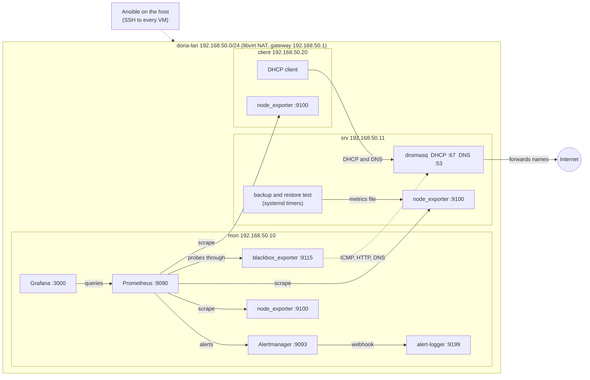

# doria
a small office network that watches itself

Three VMs on one Linux host, configured with Ansible: DHCP and DNS, monitoring and alerts, and a nightly backup that is restored and checked every night.

## What is in it

- **srv**: DHCP and DNS (dnsmasq), a file share at `/srv/share`, a nightly backup and a nightly restore test.
- **mon**: Prometheus, Alertmanager, Grafana and the blackbox exporter. Alerts are written to the journal by a small local service that stands in for email.
- **client**: a Linux machine that gets its address from DHCP, like a staff laptop.
- **scripts/drill**: opens practice tickets by breaking something in the lab.

## Tools

| Tool | Used for |
|---|---|
| libvirt, QEMU | the virtual machines and the `doria-lan` network |
| Debian 13 | the guest operating system |
| Ansible | all configuration after the install |
| dnsmasq | DHCP and DNS |
| Prometheus, node exporter, blackbox exporter | metrics and probes |
| Alertmanager | grouping and routing alerts |
| Grafana | dashboards, provisioned from files |
| systemd timers, bash | the backup and the restore test |

## Files

| Directory | Contents |
|---|---|
| `ansible/` | inventory, playbook, and one role per component |
| `libvirt/` | the virtual network definition |
| `docs/` | the addressing plan and troubleshooting notes |
| `scripts/` | the drill script |
| `walkthrough/` | what was built, in order, and what went wrong |

## Running it

Needs a Linux host with libvirt, QEMU, virt-install and Ansible, and about 4 GB of free RAM for the VMs.

1. Define the network: `virsh net-define libvirt/doria-lan.xml`, then `virsh net-start doria-lan` and `virsh net-autostart doria-lan`.
2. Install three Debian 13 VMs (`mon`, `srv`, `client`) with the addresses in `docs/addressing.md`, an `ops` user and an SSH server. Details are in `walkthrough/02-vms-and-access.md`.
3. Put your own SSH key on each VM, and set the MAC address of `client` in `ansible/group_vars/servers.yml` (find it with `virsh domiflist client`).
4. Run `cd ansible && ansible-playbook site.yml --ask-become-pass`. Run it twice. The second run should change nothing.

## Notes

- This is a lab. Prometheus, Alertmanager and Grafana run without TLS, and the sudo password is typed at each run.
- The Node Exporter Full dashboard (Grafana dashboard 1860) is used under its Apache 2.0 licence.
