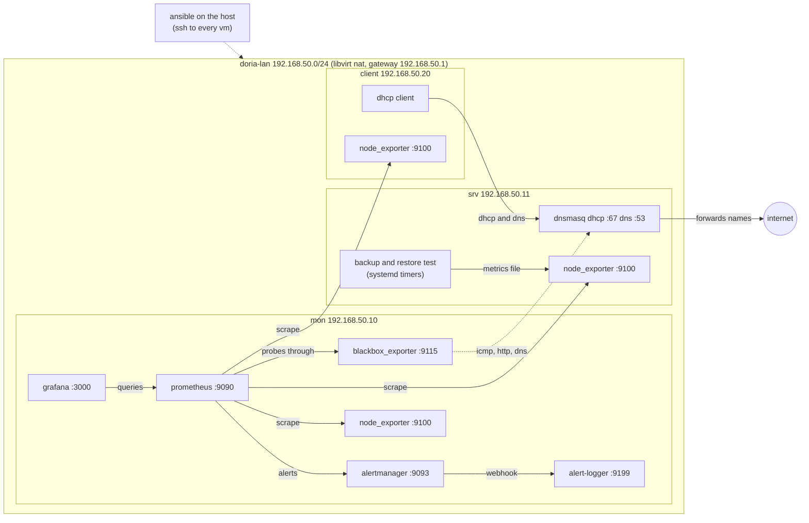

# doria

a small office network that watches itself

> three vms on one linux host, configured with ansible: dhcp and dns, monitoring and alerts, and a nightly backup that is restored and checked every night.  
> **more**z: find files and run the network in [context.md](context.md) and in the [walkthrough](./walkthrough/) directory.

| tool | for |
|---|---|
| libvirt, qemu | the virtual machines and the `doria-lan` network |
| debian 13 | the guest operating system |
| ansible | all configuration after the install |
| dnsmasq | dhcp and dns |
| prometheus, node exporter, blackbox exporter | metrics and probes |
| alertmanager | grouping and routing alerts |
| grafana | dashboards, provisioned from files |
| systemd timers, bash | the backup and the restore test |
